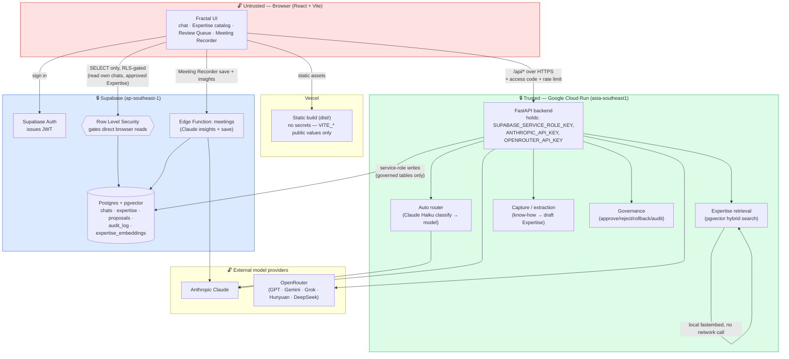
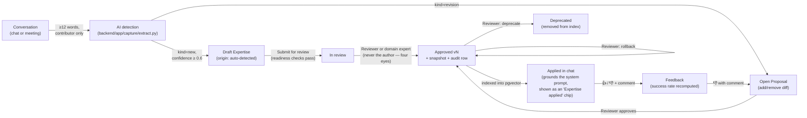

# Fractal — Architecture

## System architecture & trust boundaries

**Trust boundaries**
- The browser never holds a provider API key, a Supabase service-role key, or `DATABASE_URL` — only the public `VITE_SUPABASE_ANON_KEY` and the Cloud Run URL.
- Direct browser → Supabase reads are gated by **Row Level Security**: a user can only read their own chats, and only `approved` Expertise (drafts/in-review are invisible outside the backend).
- All writes to `expertise`, `expertise_versions`, `proposals` and `audit_log` go **only** through FastAPI using the service-role key — the browser has no write path to governed data, so "approve" or "rollback" cannot be forged client-side.
- The public demo endpoint is additionally gated by an `ACCESS_CODE` header and a per-IP rate limit (`backend/app/guard.py`), since Cloud Run allows unauthenticated traffic.

**Key design trade-offs**
- **Local embeddings (fastembed) over an API embedding model** — keeps Expertise retrieval working with zero marginal cost and no outbound dependency for the core "AI Harvest" loop, at the cost of lower embedding quality than e.g. `text-embedding-3-small`; the hybrid score adds a keyword boost to compensate.
- **Server-side Smart Auto routing with a client-side keyword fallback** — the router tries a cheap Claude Haiku classification call (better judgment of task type) but falls back to the original regex router within 2.5s so "Auto" never blocks sending a message if a provider is slow or unconfigured.
- **Governance lives entirely in the backend, not the store** — `src/store.js` used to own approve/reject/rollback logic; it's now a thin API client, so the same rules (four-eyes, reviewer-only actions, version bump, audit row) can't be bypassed by editing the front end.
- **Supabase as the single source of truth** — one Postgres instance serves pgvector search, relational data and Auth, trading some flexibility (vs. a dedicated vector DB) for a much simpler ops story inside a hackathon timeline.

## Expertise lifecycle

Every transition above (`submit`, `approve`, `reject`, `rollback`, `deprecate`, proposal `approve`/`reject`) writes a row to `audit_log` (`backend/app/governance.py::audit`), giving a complete, queryable history of who changed what Expertise and when (`GET /api/audit`).
